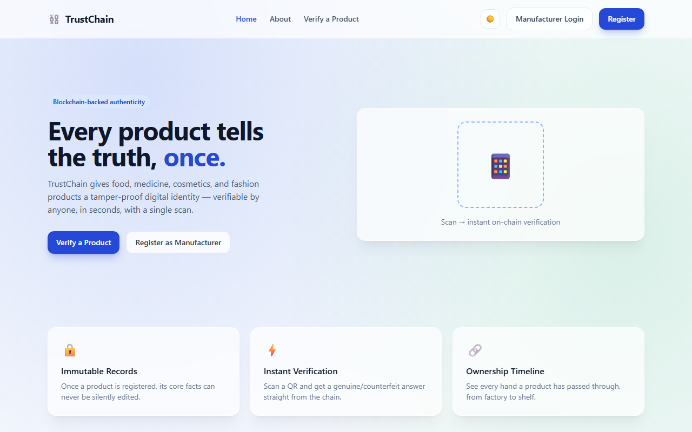
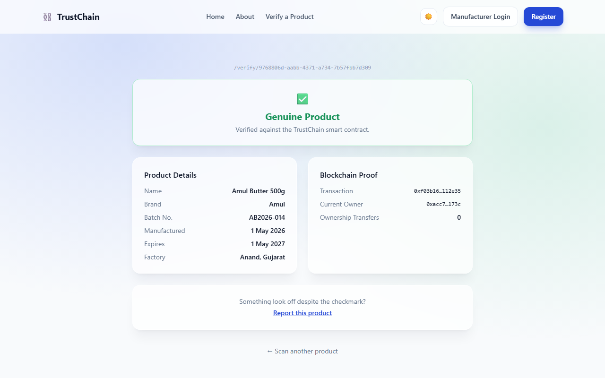
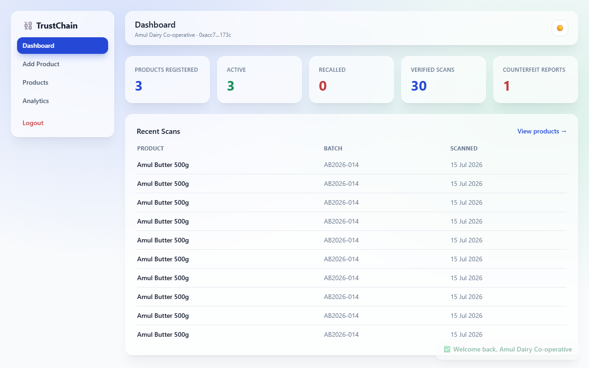
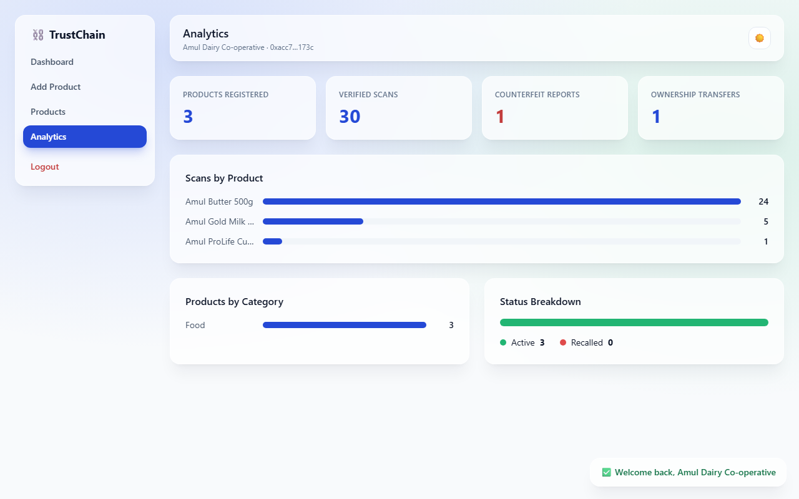

# ⛓️ TrustChain

**Blockchain-Based Product Authentication & Anti-Counterfeit System**

A final year project. Every registered product gets a digital identity written
once to the Ethereum Sepolia testnet; customers scan a QR code and get an
answer — genuine or not — sourced directly from that immutable record, not
from a database anyone could quietly edit.

> **Scope note**: this project demonstrates how blockchain provides immutable,
> transparent product records — it does not attempt to solve every real-world
> anti-counterfeit problem. A QR sticker can still be physically copied like
> any sticker; that's a known, disclosed limitation, not an oversight.

📄 **[Read the full project report →](docs/PROJECT_REPORT.md)** — problem
statement, system design, results, and screenshots, in report form.

## Screenshots

| | |
|---|---|
|  |  |
| Landing page | Verification — genuine product |
|  |  |
| Manufacturer dashboard | Analytics |

More in [docs/screenshots/](docs/screenshots/) and the [project report](docs/PROJECT_REPORT.md#61-screenshots).

## Features

- **Immutable product records** — a Solidity smart contract on Sepolia is the
  source of truth for authenticity; MongoDB is a fast cache/search layer on
  top of it, never a substitute for it.
- **QR-based verification** — scan (real camera, via `html5-qrcode`) or enter
  a product ID; get an instant genuine/counterfeit answer with full product
  details, transaction hash, and ownership history.
- **QR codes encode only the product ID** — never brand, dates, or anything
  else — independently verified by decoding a generated QR with a separate
  library.
- **Cryptographic wallet verification** — a manufacturer proves they control
  their registered wallet with a signed nonce challenge (MetaMask
  `personal_sign`), not just by typing an address into a form.
- **Manufacturer dashboard** — register products, download QR codes
  (PNG/SVG/PDF), transfer ownership, issue recalls, and see real analytics
  (scans, counterfeit reports, ownership transfers — not just page views).
- **Admin panel** — approve manufacturers, browse all products, triage
  counterfeit reports.
- **Dark mode**, glassmorphism design system, fully responsive.

## Tech Stack

**Frontend** — React, Vite, Tailwind CSS, React Router, Axios
**Backend** — Node.js, Express.js (MVC)
**Database** — MongoDB
**Blockchain** — Solidity, Ethereum Sepolia Testnet, Hardhat, ethers.js, MetaMask
**QR** — `qrcode` (generate), `html5-qrcode` (scan), `pdfkit` (PDF export)
**Auth** — JWT, bcrypt, wallet-signature verification
**Testing** — Hardhat + Chai, Jest + Supertest + `mongodb-memory-server`

## Repo Layout

```
client/      React frontend
server/      Express REST API
contracts/   Solidity smart contract
scripts/     Hardhat deploy script
test/        Smart contract test suite
artifacts/   Hardhat build output (generated)
docs/        Architecture, API, testing, deployment, and report documentation
```

See [docs/FOLDER_STRUCTURE.md](docs/FOLDER_STRUCTURE.md) for the full tree.

## Getting Started

Requires Node.js and a running local MongoDB (`mongodb://127.0.0.1:27017` by
default — use `127.0.0.1`, not `localhost`, to avoid an IPv6/IPv4 loopback
mismatch on Windows).

```bash
# Backend
cd server
cp .env.example .env      # fill in JWT_SECRET etc.
npm install
npm run dev                # http://localhost:5000

# Frontend (separate terminal)
cd client
cp .env.example .env
npm install
npm run dev                # http://localhost:5173
```

There's no self-registration for admins — insert one directly into the
`admins` collection (name/email/bcrypt-hashed password/role). A manufacturer
registers via the UI (connecting a wallet as part of registration), then
needs that admin account to approve them before they can log in.

Contracts (`contracts/TrustChain.sol`) compile independently from the repo root:
```bash
npm install
npx hardhat compile
```

Going live on real Sepolia (instead of the local Hardhat node used for
development) is documented in [docs/DEPLOYMENT.md](docs/DEPLOYMENT.md).
Hosting the app itself (Vercel/Render/MongoDB Atlas) is in
[docs/HOSTING.md](docs/HOSTING.md).

## Running Tests

```bash
npx hardhat test        # smart contract (22 tests)
cd server && npm test   # backend API (35 tests)
```

57 tests total, all passing. See [docs/TESTING.md](docs/TESTING.md) for what
each suite covers, what's mocked vs. real, and why.

## Documentation

| Doc | Covers |
|---|---|
| [Project Report](docs/PROJECT_REPORT.md) | The full academic report — problem statement, design, results |
| [Architecture](docs/ARCHITECTURE.md) | System design, component diagram, key architectural decisions |
| [Folder Structure](docs/FOLDER_STRUCTURE.md) | Full repo layout and naming conventions |
| [Database Schema](docs/DATABASE_SCHEMA.md) | All 6 MongoDB models, field by field |
| [Smart Contract Reference](docs/smart-contract/TrustChain.md) | Every function, event, and access-control rule |
| [API Reference](docs/api/API_REFERENCE.md) | Every REST endpoint, request/response shape |
| [Frontend](docs/FRONTEND.md) | Component structure, design system, verification notes |
| [Deployment (Sepolia)](docs/DEPLOYMENT.md) | Going live on real Sepolia; real bugs found doing it locally |
| [Testing](docs/TESTING.md) | The 57-test automated suite in detail |
| [Hosting](docs/HOSTING.md) | Deploying the app to Vercel/Render/MongoDB Atlas |

## How this was verified

Every phase was checked against its actual running components, not assumed
correct from the code: a real local Ethereum node for blockchain integration
(40+ stress-test cycles), real browser automation for every frontend flow
(including synthesizing a fake camera feed to prove QR *scanning*, not just
generation, actually works), real cryptographic signatures for wallet
auth testing, and a real production build driven in a browser before calling
deployment done. Several real bugs — nonce mismanagement, a hidden-container
scanner bug, a stale-nonce response cache, a 604KB bundle-size regression —
were caught this way and are documented where they were fixed, not hidden.

## License

Academic project — no license specified.
