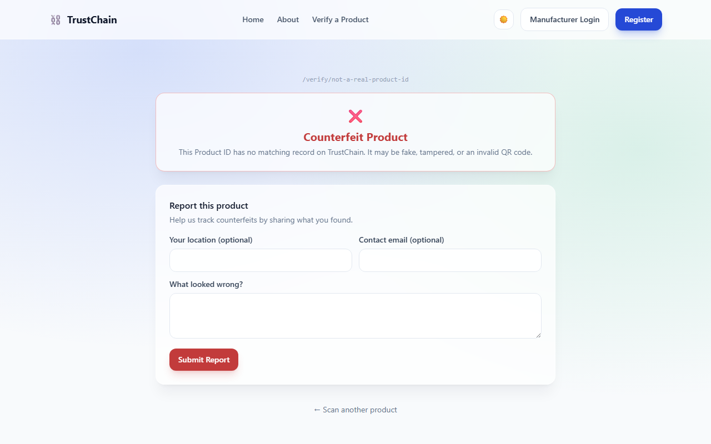
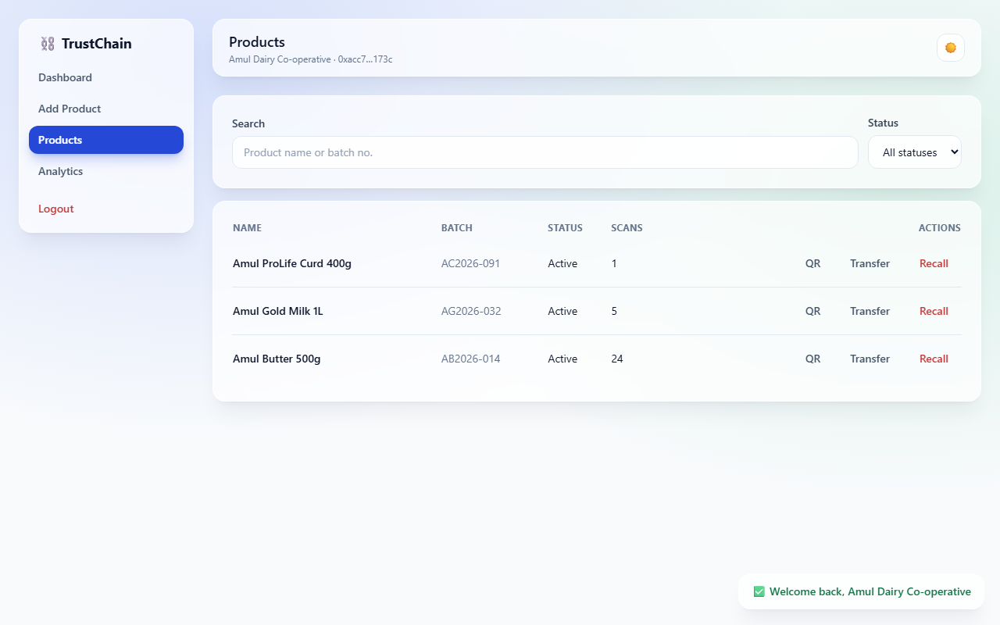
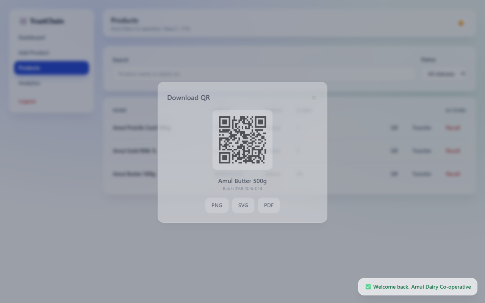
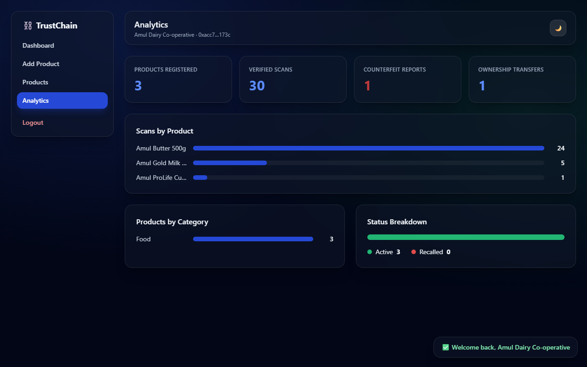
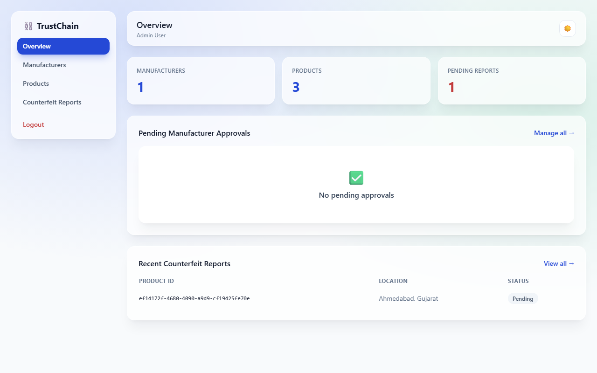
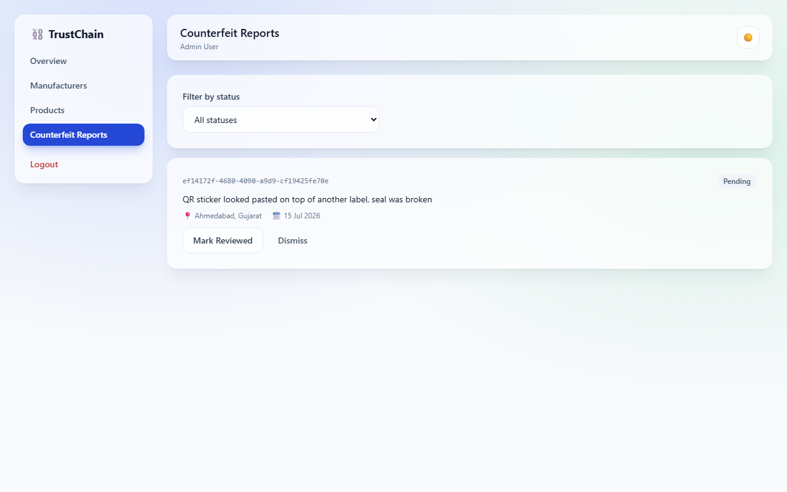

# TrustChain
## Blockchain-Based Product Authentication & Anti-Counterfeit System

*Final Year Project Report*

---

## Abstract

Counterfeit products in food, medicine, cosmetics, and fashion cause real
harm, and centralized authenticity databases have a structural weakness: the
company running the database can also quietly edit it. TrustChain addresses
this by giving every registered product a digital identity written once to
the Ethereum Sepolia blockchain. A customer scans a QR code printed on the
packaging and gets an answer — genuine or not — sourced directly from that
immutable record, not from a database the same company could edit after the
fact. The system was built across twelve phases: architecture, a Solidity
smart contract, a Node.js/Express REST API, a React frontend, real blockchain
integration, QR generation, camera-based QR scanning, cryptographic wallet
authentication, manufacturer/admin dashboards, an automated test suite (57
tests), production deployment configuration, and this documentation. At every
phase, the system was verified against its *actual* running components
(a real local Ethereum node, a real MongoDB instance, a real browser) rather
than assumed correct from the code alone — this report documents what that
verification found, including the real bugs it caught.

## Scope Note

This project demonstrates how blockchain provides immutable, transparent
product records. It does not attempt to solve every real-world
anti-counterfeit problem — a QR code sticker can still be physically peeled
off a genuine product and stuck onto a counterfeit one. That is a known,
accepted limitation of any QR-based system, blockchain-backed or not, and is
disclosed here rather than glossed over.

---

## 1. Introduction

### 1.1 Problem Statement

Fake products routinely copy genuine packaging closely enough that a
customer cannot tell them apart by inspection. Manufacturers and regulators
need a way for any customer, at the point of purchase, to independently
verify that a specific unit — identified by its batch and product ID — was
actually produced by the manufacturer it claims to be from, and has not been
tampered with or expired.

### 1.2 Objectives

1. Give every physical product a unique, tamper-evident digital record.
2. Let any customer verify a product's authenticity in seconds, with no
   login and no app install — a QR scan and a webpage.
3. Make the immutability guarantee real, not cosmetic: prove that once
   registered, a product's core facts (brand, batch, dates, factory) cannot
   be silently altered by anyone, including the system operator.
4. Give manufacturers a working dashboard to register products, monitor
   scans, transfer ownership along a supply chain, and issue recalls.
5. Give administrators oversight: approving manufacturers and triaging
   counterfeit reports from customers.

### 1.3 Scope and Limitations

- Targets the Ethereum Sepolia **testnet**, not mainnet — appropriate for an
  academic demonstration where real transaction fees are not the point.
- QR codes are physical stickers and can be copied like any other sticker;
  the guarantee is about what happens *after* a genuine QR is scanned (the
  data behind it cannot be quietly edited), not about counterfeiting the
  sticker itself.
- Geolocation of scans and reports was deliberately left out rather than
  faked — it would need the *customer's* browser location permission (not
  the manufacturer viewing the dashboard), which is a different UX problem
  than this project set out to solve.

---

## 2. Existing Approaches and Their Limitations

Two approaches dominate current anti-counterfeit tracking:

- **Printed serial numbers / holograms** — copyable, and offer no live
  verification; a customer has no way to check a number against anything.
- **Centralized verification databases** — solve the "check against
  something" problem, but the operator of that database can edit any record
  at any time, including retroactively, with no external audit trail. A
  customer verifying against such a database is trusting the operator not to
  have tampered with it — precisely the trust a blockchain-backed system
  removes.

TrustChain keeps a centralized database (MongoDB) for what it's good at —
fast search, analytics, file storage — but moves the actual authenticity
claim onto a blockchain, where it can be independently audited by anyone,
including on a public block explorer, and can only be *appended* to, never
silently edited.

---

## 3. System Design

### 3.1 Architecture

```
                         ┌─────────────────────────┐
                         │        MetaMask          │
                         │ (manufacturer wallet      │
                         │  registration proof)      │
                         └────────────┬─────────────┘
                                      │ eth_sign / connect
                                      ▼
┌───────────────┐   HTTPS/REST   ┌─────────────────────┐   ethers.js   ┌───────────────────────┐
│   client/      │◄──────────────►│      server/         │◄─────────────►│  contracts/            │
│  React + Vite  │    JSON/JWT    │  Node.js + Express   │   JSON-RPC    │  TrustChain.sol        │
│                │                │  (MVC)                │               │  (Sepolia testnet)     │
└───────────────┘                └──────────┬───────────┘               └───────────────────────┘
                                             │
                                             ▼
                                  ┌───────────────────────┐
                                  │   MongoDB              │
                                  │  (fast cache, search,  │
                                  │   analytics — never     │
                                  │   the authenticity      │
                                  │   source of truth)      │
                                  └───────────────────────┘
```

Full component diagram, data-flow walkthroughs, and every architectural
decision (with reasoning) are in [ARCHITECTURE.md](ARCHITECTURE.md). Two
decisions are load-bearing enough to restate here:

**Who signs blockchain transactions?** The backend holds one operator wallet
and submits every `registerProduct`/`transferOwnership`/`recallProduct`
transaction itself — manufacturers don't sign their own registrations. This
avoids funding gas for every manufacturer individually and matches the
project's own flow diagram (`Manufacturer → Backend → Smart Contract`). The
trade-off — trust is placed in the backend's key custody — is the same
relayer pattern many production blockchain apps use, and is disclosed rather
than hidden.

**What proves a manufacturer's wallet is really theirs?** Not the login —
login stays plain email/password. Instead, exactly once, at registration, the
manufacturer's wallet signs a one-time nonce (`personal_sign`), and the
backend recovers the signer with `ethers.verifyMessage` and rejects
registration if it doesn't match the claimed address. A typed-in address with
no signature is never accepted.

### 3.2 Database Design

Six MongoDB collections — full field-by-field schema in
[DATABASE_SCHEMA.md](DATABASE_SCHEMA.md):

| Collection | Purpose |
|---|---|
| `Manufacturer` | account, wallet, approval status |
| `Admin` | seeded/invited, not self-registered |
| `Product` | off-chain mirror + cache of the on-chain record |
| `Ownership` | append-only transfer log |
| `CounterfeitReport` | customer-submitted, works even for a fake/unknown productId |
| `ScanEvent` | one row per genuine-product verification, backing the dashboard's "Recent Scans" |

The database is never the authority on "is this genuine" — that question is
always answered by reading the smart contract. If every MongoDB record were
deleted, a genuine product would still verify as genuine.

### 3.3 Smart Contract Design

`contracts/TrustChain.sol` — full function/event reference in
[smart-contract/TrustChain.md](smart-contract/TrustChain.md).

- `registerProduct`, `transferOwnership`, `recallProduct` — `onlyOwner`
  (the backend's operator wallet)
- `verifyProduct` — public, **never reverts**, so a fake/unknown QR code
  (an expected, common input) returns a clean `false` instead of throwing
- `getProduct`, `getOwnershipHistory` — public, revert only on a genuinely
  unknown productId
- Events (`ProductRegistered`, `OwnershipTransferred`, `ProductRecalled`)
  deliberately keep `productId` **un**-indexed, so a block explorer shows the
  readable ID rather than a hash — the whole point of the system is public
  auditability

---

## 4. Implementation

### 4.1 Technology Stack

| Layer | Technology |
|---|---|
| Frontend | React 18, Vite, Tailwind CSS, React Router, Axios |
| Backend | Node.js, Express.js (MVC) |
| Database | MongoDB, Mongoose |
| Blockchain | Solidity ^0.8.24, Ethereum Sepolia, Hardhat, ethers.js v6 |
| Wallet | MetaMask (`personal_sign` challenge-response) |
| QR | `qrcode` (generate), `html5-qrcode` (camera scan), `pdfkit` (PDF export) |
| Auth | JWT, bcrypt, `express-rate-limit` |
| Testing | Hardhat + Chai (contract), Jest + Supertest + `mongodb-memory-server` (backend) |

### 4.2 Build Phases

The system was built in twelve phases, each verified before moving to the
next rather than assumed working from the code alone:

1. **Architecture & Planning** — component diagram, folder structure,
   low-fidelity wireframes for all 15 screens, database schema.
2. **Smart Contract** — `TrustChain.sol`, compiled clean (a `viaIR: true`
   Hardhat setting was needed once `registerProduct`'s parameter count hit
   Solidity's "stack too deep" limit).
3. **Backend API** — Express MVC, JWT auth, a *mocked* blockchain service so
   the backend and frontend could be built before Phase 5's real chain wiring.
4. **Frontend** — React SPA, Tailwind glass-morphism design system, dark
   mode, all 15 pages, verified end-to-end with a real MongoDB and a real
   browser (Playwright).
5. **Blockchain Integration** — the mock replaced with real `ethers.js`
   calls, verified against a real local Hardhat chain (not just unit-mocked).
   This stress-testing surfaced and fixed three real bugs (nonce
   mismanagement, a stale-nonce response cache, and an opaque error under
   load) — documented in detail in [DEPLOYMENT.md](DEPLOYMENT.md), since
   they're exactly the kind of thing a real deployment would otherwise hit
   cold.
6. **QR Generation** — server-generates a QR encoding *only* the productId
   (never brand/dates, per the project's own data-minimization rule),
   independently re-decoded with a separate library to confirm that promise
   was actually kept.
7. **QR Scanner** — real camera-based scanning (`html5-qrcode`). Verified by
   synthesizing a fake camera video feed containing an actual QR image (no
   physical camera available in the automated-testing environment) and
   confirming the app correctly decoded it and routed to the verification
   page — this caught a real bug where the scanner's container was hidden
   at the exact moment the camera needed to measure it.
8. **Authentication** — the wallet-signature registration flow described in
   §3.1, plus rate limiting on auth/verification/report endpoints.
9. **Dashboards** — re-checked the original spec's analytics requirements
   against what existed and found two real gaps (Counterfeit Reports and
   Ownership Transfers weren't surfaced; Recent Scans was only a counter, not
   a browsable list) and closed them.
10. **Testing** — 57 automated tests (see §5).
11. **Deployment** — production hardening (`helmet`, `compression`,
    route-level code splitting), a real production build tested in a
    browser, hosting configuration for Vercel/Render/MongoDB Atlas.
12. **Documentation** — this report, and a final consistency pass across
    every document written during the build.

---

## 5. Testing

Full detail in [TESTING.md](TESTING.md). Summary:

| Suite | Tool | Tests | Covers |
|---|---|---|---|
| Smart contract | Hardhat + Chai | 22 | Every function and revert condition in `TrustChain.sol` |
| Backend API | Jest + Supertest | 35 | Auth (incl. real wallet-signature verification), products, verification, admin, reports, rate limiting |

**57 tests total, all passing.** The backend suite runs against a real
in-memory MongoDB (`mongodb-memory-server`) — not a mocked database — with
only the blockchain and QR-generation services mocked (both independently
verified for real in Phases 5–7; re-running them on every test invocation
added no coverage, only ~4 seconds of disk I/O per test from this repo living
under OneDrive's file-sync interception, which mocking also fixed).

Three real bugs were found by *running* the test suite, not by writing it:
a transitive module-load failure when the blockchain service wasn't mocked
in every file that needed it, a mock that threw plain errors instead of the
same `AppError` shape the real service produces (masking a 409 as a 500),
and a rate limiter that would have made its own test file flaky.

---

## 6. Results

### 6.1 Screenshots

All captured from the actual running application against seeded demo data —
not mockups.

**Landing page**


**Verification — genuine product**


**Verification — counterfeit / unknown product**


**Manufacturer dashboard**


**Product list**


**QR download**


**Analytics**


**Analytics — dark mode**


**Admin dashboard**


**Admin — counterfeit reports**


### 6.2 What was verified, and how

Every phase's "done" claim in this project was backed by running the actual
system, not by reading the code and assuming it worked:

- Real local Ethereum node (Hardhat) for blockchain integration — 40+
  register/recall cycles and 20 ownership transfers with zero failures after
  fixing the bugs found along the way.
- Real browser automation (Playwright) for every frontend phase, including
  synthesizing a fake camera feed to prove the QR *scanning* code path
  (not just the QR *generation* code path) actually works.
- Real cryptographic signatures (`ethers.Wallet`, not a stub) for wallet
  authentication testing — the private key never touched browser JavaScript,
  matching the actual trust boundary MetaMask itself has.
- A real production build (`vite build` + `vite preview`) driven with a
  browser to catch build-only issues (a genuine bundle-size problem,
  fixed with code-splitting) before calling deployment "done."

---

## 7. Deployment

Full guide in [HOSTING.md](HOSTING.md) (application hosting) and
[DEPLOYMENT.md](DEPLOYMENT.md) (Sepolia smart contract deployment). Both
require accounts on external services (Vercel, Render, MongoDB Atlas, an RPC
provider) that only the project owner can create — the codebase side of
deployment (build configs, security headers, SPA routing, environment
variable templates) is complete and tested; the account-creation side is a
short, documented manual step.

---

## 8. Conclusion

TrustChain demonstrates a complete, working blockchain-based product
authentication system: a smart contract enforcing immutability and
access control, a REST API bridging that contract to a conventional
database for speed and analytics, a React frontend covering all three user
roles (customer, manufacturer, admin), real QR generation and camera
scanning, cryptographic wallet-based registration proof, and an automated
test suite. Every phase was verified against a real running instance of its
relevant components rather than left as an assumption, and several real
bugs — in nonce handling, in test mocking, in modal accessibility, in
production bundle size — were found and fixed specifically *because* of that
verification discipline, not despite it.

## 9. Future Scope

- Move `server/uploads/` (QR PNGs, report photos) to S3-compatible object
  storage, removing the free-tier-hosting ephemeral-disk limitation noted in
  [HOSTING.md](HOSTING.md).
- IPFS storage for counterfeit-report photos, as originally scoped as an
  optional bonus feature.
- A seed script for the first admin account, removing the current
  insert-directly-into-MongoDB manual step.
- Multi-chain support (e.g. Polygon) for lower real-world gas costs if this
  ever moved past a testnet demonstration.

## References

- Ethereum documentation — [ethereum.org/developers](https://ethereum.org/en/developers/)
- Hardhat documentation — [hardhat.org](https://hardhat.org/)
- ethers.js documentation — [docs.ethers.org](https://docs.ethers.org/)
- MongoDB / Mongoose documentation — [mongoosejs.com](https://mongoosejs.com/)
- OpenZeppelin Contracts (design patterns referenced, not directly imported) — [docs.openzeppelin.com](https://docs.openzeppelin.com/)
